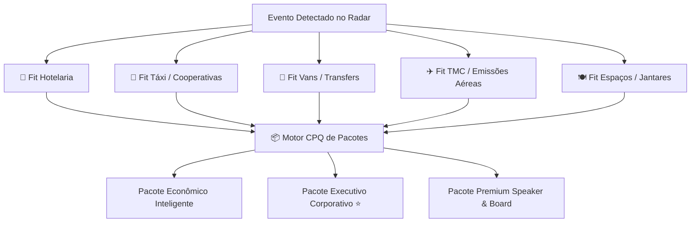

# 📘 Guia Operacional e Metodologia de Fit — MICE Intelligence SP

Este documento estabelece a metodologia técnica, os critérios de pontuação de fit por modalidade (Hotel, Táxi, Transfer/Van, TMC/Aéreo e Restaurantes), as regras de negócio para São Paulo e o plano de ação prático para o MVP com a rede de contatos.

---

## 1. Critérios de Pontuação de Fit por Modalidade

Cada tipo de fornecedor atende a uma dor específica na jornada do participante e organizador de eventos. Abaixo estão os pesos e critérios matemáticos aplicados no motor de cálculo.



---

### A. 🏨 Fit Hotelaria (`Hotel Fit Score`)
O hotel é a âncora do pacote MICE. O fit não depende apenas de luxo, mas de viabilidade logística e bloqueio de quartos (*room block*).

* **Peso 1 — Distância do Evento (35%)**:
  * $\le 3\text{ km}$: 100 pts
  * $3.1 \text{ a } 6\text{ km}$: 85 pts
  * $6.1 \text{ a } 12\text{ km}$: 60 pts
  * $> 12\text{ km}$: 30 pts
* **Peso 2 — Preço e Saving Negociado MICE (25%)**:
  * Desconto $\ge 15\%$ sobre tarifa balcão/pública.
* **Peso 3 — Capacidade de Room Block (20%)**:
  * Capacidade de absorver blocos de 50 a 200 quartos simultâneos sem dispersar o grupo.
* **Peso 4 — Facilidades Corporativas e SLA (10%)**:
  * Café da manhã incluso, salas de reunião para credenciamento/apoio e SLA de confirmação de reserva $\le 4\text{ horas}$.
* **Peso 5 — Avaliação de Qualidade e Histórico (10%)**:
  * Avaliação em plataformas $\ge 8.0/10$ e histórico positivo de no-show/faturamento.

---

### B. 🚕 Fit Táxi / Cooperativas (`Taxi Fit Score`)
O táxi é ideal para **dispersão e flexibilidade individual** (chegadas pingadas em aeroportos, jantares avulsos e horários desencontrados).

* **Quando o Táxi tem Alto Fit**:
  * Participantes chegando em voos dispersos ao longo de todo o dia em Congonhas (CGH) ou Guarulhos (GRU).
  * Diretores e palestrantes que exigem saídas imediatas sem esperar lotação de van.
* **Critérios de Pontuação**:
  1. **Cobertura Aeroportuária CGH + GRU (30%)**: Postos dedicados nos terminais para embarque prioritário sem fila.
  2. **Faturamento Pós-Pago e Voucher Digital (25%)**: Elimina reembolso e despesas em cartão pessoal do colaborador.
  3. **Capacidade de Pico Simultâneo (20%)**: Capacidade de atender 50+ corridas no encerramento das plenárias.
  4. **SLA de Chegada (15%)**: Tempo médio de espera inferior a 10 minutos.
  5. **Comissionamento / Repasse B2B (10%)**: Repasse de fee acordado (7% a 10%).

---

### C. 🚐 Fit Vans, Micro-ônibus e Ônibus (`Van / Transfer Fit Score`)
O transfer compartilhado é o **campeão de eficiência de custo e pontualidade** para grupos concentrados no mesmo hotel.

* **Quando a Van/Ônibus tem Alto Fit**:
  * Hotel localizado a mais de 3 km do centro de convenções (necessidade de shuttle contínuo).
  * Grupos de 15 a 50 pessoas chegando no mesmo voo ou voos com janela de até 45 minutos.
* **Critérios de Pontuação**:
  1. **Diversidade da Frota (30%)**: Vans executivas (15 lug.), micro-ônibus (28 lug.) e ônibus rodoviários (46 lug.).
  2. **Tecnologia e Segurança (25%)**: Rastreamento GPS em tempo real, monitoramento da central e atendimento 24/7.
  3. **Custo da Diária / Rota (20%)**: Preço competitivo para diárias de 10h com franquia de km adequada.
  4. **Perfil dos Motoristas (15%)**: Traje executivo, treinamento de receptivo e opção de motoristas bilíngues.
  5. **Histórico em Grandes Eventos (10%)**: Experiência comprovada em centros de convenções de SP.

---

### D. ✈️ Fit TMC / Emissões Aéreas Parceiras (`TMC Fit Score`)
Em vez de arcar com o custo de R$ 500k+ de garantias IATA e risco de crédito, conectamos uma TMC de confiança para emitir os bilhetes.

* **Critérios de Pontuação**:
  1. **Código IATA Ativo e Acordo BSP com Consolidadoras (35%)**: Conexão com BRT, Ancoradouro, Sakura, etc.
  2. **Fee de Emissão Competitivo (25%)**: Fee nacional entre R$ 30 e R$ 40 por bilhete.
  3. **Plantão Emergencial 24/7 e Gestor Dedicado (20%)**: Resolução de cancelamentos de voos em tempo real.
  4. **Prazo de Faturamento Corporativo (10%)**: Faturamento a 21 ou 28 dias para o cliente corporativo.
  5. **Repasse de Parceria (10%)**: Repasse de 30% a 50% do fee de emissão ou comissão negociada.

---

### E. 🍽️ Fit Restaurantes e Espaços Privativos (`Restaurant Fit Score`)
* **Critérios**:
  * Capacidade para grupos de 50 a 250 pessoas em salas privativas com infraestrutura de som/projetor.
  * Menu fechado corporativo com bebidas inclusas para evitar estouro de budget.
  * Localização nos eixos nobres de negócios (Itaim, Berrini, Moema, Jardins).

---

## 2. Matriz de Decisão: Táxi vs. Van vs. Ônibus

Para evitar desperdício de orçamento e garantir a satisfação do cliente corporativo, a plataforma adota a seguinte árvore de decisão:

| Cenário Operacional | Solução Recomendada | Justificativa |
| :--- | :---: | :--- |
| **Chegadas nos Aeroportos (Voos dispersos ao longo do dia)** | **Táxi via Voucher / App Corporativo** | Mais barato e flexível que deixar van ociosa no aeroporto. |
| **Chegadas nos Aeroportos (Grupo $\ge 6$ pessoas na mesma hora)** | **Van Executiva Receptivo** | Custo por passageiro cai até 60% e oferece recepção com placa na saída do desembarque. |
| **Hotel $\leftrightarrow$ Evento (Hotel a $\le 1.5\text{ km}$)** | **Táxi sob demanda / Caminhada guiada** | Custo de van não se justifica para distâncias a pé. |
| **Hotel $\leftrightarrow$ Evento (Hotel a $\ge 3\text{ km}$ com 30+ hóspedes)** | **Shuttle Contínuo de Vans / Ônibus** | Garante que todo o grupo chegue no horário da abertura sem atrasos ou despesas dispersas. |
| **Speakers VIP / Diretoria C-Level** | **Carro Executivo Dedicado** | Atendimento exclusivo com motorista à disposição integral. |

---

## 3. Fontes de Captação do Radar de Eventos em São Paulo (MVP)

Para alimentar o radar de eventos sem custo inicial de desenvolvimento, mapeamos as principais fontes públicas estruturadas:

1. **Centros de Convenções e Pavilhões**:
   * *São Paulo Expo*: Agenda oficial de feiras e congressos técnicos.
   * *Transamerica Expo Center*: Forte concentração de congressos médicos, farmacêuticos e TI.
   * *Distrito Anhembi*: Grandes convenções corporativas, feiras de varejo e associações.
   * *Centro de Convenções Frei Caneca e WTC Events Center*: Eventos de gestão, direito, finanças e summits corporativos.
2. **Associações Setoriais e Sociedades Médicas**:
   * Associação Médica Brasileira (AMB), Sociedade Brasileira de Cardiologia (SBC), Oncologia, Ortopedia.
   * FecomercioSP, ABIMAQ, FEBRABAN, ABES.
3. **Plataformas de Inscrição e Divulgação**:
   * Sympla Corporate, Eventbrite, Doity e portais setoriais.
4. **Inteligência de Enriquecimento B2B**:
   * Consulta de CNPJs na Receita Federal para capturar endereço e razão social dos organizadores.
   * Busca no LinkedIn dos cargos-chave: *"Gerente de Compras Indiretas"*, *"Head de Eventos Corporativos"*, *"Diretor de Marketing"*, *"Gerente de Facilities/Viagens"*.

---

## 4. Script Comercial da Abordagem Proativa (Gisele)

A abordagem não pede cotação; ela entrega inteligência pronta.

> **Assunto**: Solução estruturada de hospedagem e mobilidade para o [Nome do Evento]
>
> *"Olá, [Nome do Decisor], tudo bem?*
>
> *Mapeamos que a [Nome da Empresa] está organizando o [Nome do Evento] no [Local do Evento] em [Mês/Ano], com estimativa de [X] participantes de fora de São Paulo.*
>
> *Estruturamos previamente 3 cenários prontos de hospedagem em hotéis a menos de 4 km do pavilhão com tarifas corporativas pré-negociadas (até 22,5% de saving) e logística completa de transfers e táxis credenciados.*
>
> *Podemos agendar 15 minutos para apresentar os cenários comparativos e liberar o faturamento direto para a sua equipe?"*

---

## 5. Mapeamento Estadual de São Paulo & Polos Agro/MICE

A plataforma cobre integralmente o Estado de São Paulo para eventos a partir de **100 participantes**:
1. **São Paulo Capital**: São Paulo Expo, Distrito Anhembi, Transamerica Expo Center, Frei Caneca, WTC Events Center.
2. **Polo Ribeirão Preto & Sertãozinho**: Agrishow, Fenasucro & Agrocana. Hotéis JP & Resort, Wyndham Garden, Tryp, Mont Blanc. Cooperativa Rádio Táxi Ribeirão Preto (Expresso RAO).
3. **Polo Campinas & Resorts**: Convenções Corporativas e Hortitec (Royal Palm Hall & Plaza, Meliá Campinas, Bourbon Atibaia). Cooperativa CooperCamp / Viracopos Express.
4. **Polo Noroeste Paulista (São José do Rio Preto & Araçatuba)**: Expo Rio Preto. Quality Hotel Saint Paul, Ibis Rio Preto, Cooperativa CooperRioPreto.
5. **Polo Piracicaba AgTech & Avaré**: Fóruns AgTech, Feicorte e EMAPA Avaré. Beira Rio Palace, Hotel Nacional Inn Piracicaba.
6. **Polo Baixada Santista & Porto de Santos**: Fórum Santos Export. Parque Balneário Hotel, Bourbon Santos Convention, Cooperativa Rádio Táxi de Santos.
7. **Polo Campos do Jordão**: Fórum de Inverno do Agronegócio e Liderança C-Level. Grande Hotel Senac, Hotel Toriba.

---

## 6. Aprendizados Operacionais & Debriefing Pós-Evento (Memória do Sistema)

Auditoria das edições anteriores consolidadas no motor preditivo:
- **Janela de Esgotamento Hoteleiro**: Hotéis de raio curto (< 8 km) esgotam entre **D-120 e D-90**. Utilizar a proteção **Room Block Shield** para fechar contratos com liberação escalonada sem multa até D-30.
- **Táxi Credenciado vs. Aplicativos (Uber/99)**:
  - *Aplicativos Avulsos*: Registram 52 minutos de espera na saída, tarifa dinâmica de 3.8x e 34% de cancelamentos por motoristas.
  - *Cooperativas Homologadas*: Bolsão prioritário com SLA de 6 minutos, tarifa fixa tabelada, **acesso 100% liberado às faixas de ônibus** e fatura única com voucher digital.
- **Fretamento Balanceado**: Proporção de 1 ônibus executivo (46p) para 2 a 3 vans executivas (15p) em circuitos circulares nos horários de pico.

---

## 7. Como Executar o Sistema Completo

Para inicializar a plataforma com interface web interativa, motor preditivo e estúdio de customização manual:

```bash
node server.js
```
Acesse no navegador: `http://localhost:3000`
